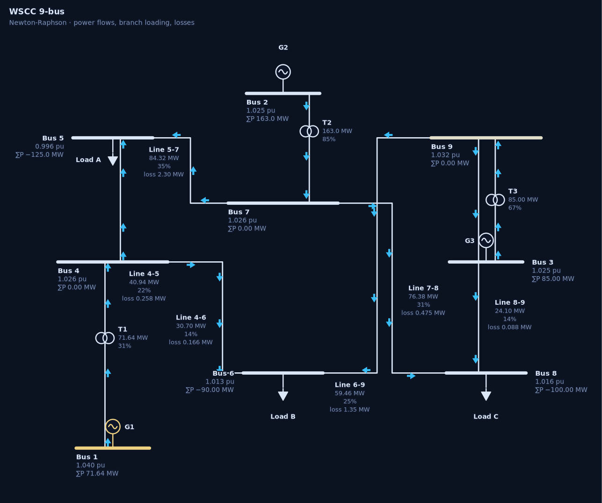
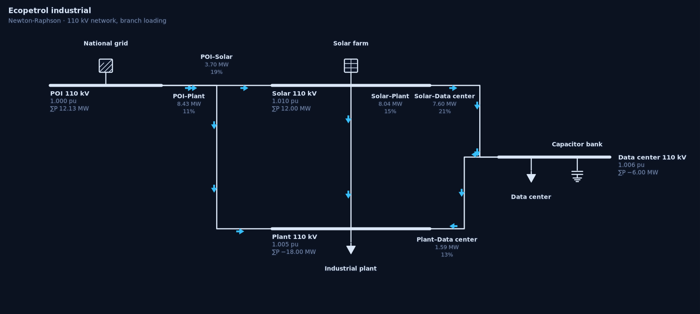
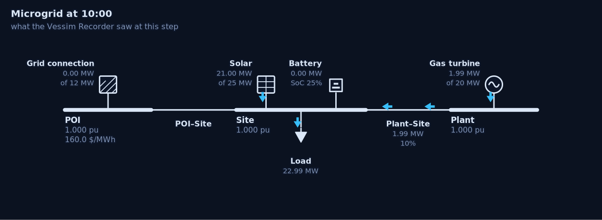
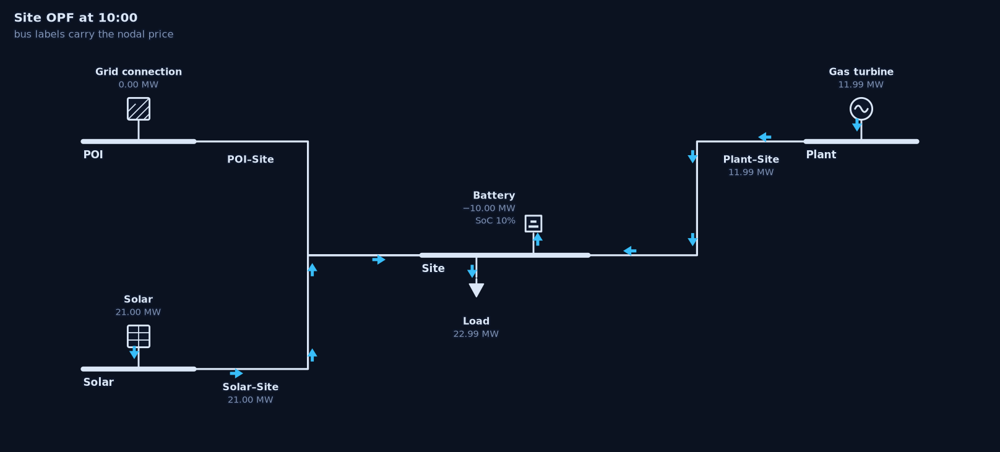

# ⚡ Vessim ↔ PyPSA — an interactive microgrid laboratory

**Five official [Vessim](https://github.com/dos-group/vessim) examples simulated for real, a sixth
built on the project's published roadmap, the two
[AdjieBrotot](https://tool.adjiebrotots.com) simulators ported to Python with their editable sheets
and their single-line diagrams, and the same physics solved with
[PyPSA](https://github.com/PyPSA/PyPSA).**

The question the whole dashboard is built around: *how much is it worth planning with a network and
a horizon, instead of dispatching with rules?*

[](../../actions/workflows/ci.yml)
`MIT` · `Python 3.11+` · `Streamlit` · `HiGHS`

---

## Contents

1. [What it looks like](#what-it-looks-like)
2. [What is inside](#what-is-inside)
3. [The views of every case](#the-views-of-every-case)
4. [Computing systems in every case](#computing-systems-in-every-case)
5. [Case 06 — the roadmap case](#case-06--the-roadmap-case)
6. [Reading it without drowning](#reading-it-without-drowning)
7. [The viewer, reproduced](#the-viewer-reproduced)
8. [The papers, reproduced](#the-papers-reproduced)
9. [The single-line diagram](#the-single-line-diagram)
10. [The maths sheet](#the-maths-sheet)
11. [When Vessim, when PyPSA, when both](#when-vessim-when-pypsa-when-both)
12. [What PyPSA cannot see](#what-pypsa-cannot-see)
13. [Change the policy](#change-the-policy)
14. [Hardware in the loop](#hardware-in-the-loop)
15. [Results you can reproduce](#results-you-can-reproduce)
16. [Run it locally](#run-it-locally)
17. [Publish it on Streamlit Community Cloud](#publish-it-on-streamlit-community-cloud)
18. [Repository layout](#repository-layout)
19. [How each engine works](#how-each-engine-works)
20. [Teaching script](#teaching-script)
21. [Reproducibility and versions](#reproducibility-and-versions)
22. [Attribution and licence](#attribution-and-licence)

---

## What it looks like

Every network in the app is drawn by the SVG engine in [`sld.py`](sld.py): bus bars, the usual
device symbols, orthogonal feeders and flow arrows. No plotting library, no Graphviz.

**WSCC 9-bus, Newton-Raphson (⚡ LoadFlow tab).** Bars are coloured by voltage, arrows show the
direction of active power, and each branch carries its flow, its loading and its losses. Against
`pypsa.pf()` the bus voltages agree to 7.6 × 10⁻¹² p.u.



**The Ecopetrol 110 kV network (case 05, ⚡ LoadFlow tab).** POI, solar farm, process plant and data
centre, with the capacitor bank hanging off the data-centre bus.



**The microgrid as Vessim left it at 10:00 (🏠 Vessim tab).** Not an optimal dispatch: what the
actors actually did at that step — the grid tie idle, 21 MW of PV, the battery holding, the gas
turbine covering the rest of the 22.99 MW load.



**The same hour re-solved by PyPSA (🔗 Vessim + PyPSA tab).** Bus labels carry the nodal price; the
battery charges 10 MW because the site price is high, and the residual (load − grid − solar − gas −
battery) is exactly zero. Putting this next to the picture above is the point of the dashboard.



---

## What is inside

| # | Case | Origin | Scale |
|---|------|--------|-------|
| 01 | **Basic simulation** | `vessim/examples/basic_example.py` | 700 W, 1 kWh, 2.4 kWp |
| 02 | **Solar + battery** | `strategy_comparison.py` | 3.2 kWp, 3 kWh battery |
| 03 | **Carbon-aware workload** | `demand_response.py` + WattTime-like signals | 35 % deferrable load |
| 04 | **Software-in-the-loop** | `live_server_monitoring.py` (SiL) | one real CPU process |
| 05 | **Ecopetrol industrial** | new case (Colombia) | 18 MW plant + 6 MW data centre, 25 MWp, 40 MWh BESS |

Every case runs a real `vessim.Environment` — actors, dispatchables, dispatch policy, grid signals
and a `Recorder` — and produces a trace that is then re-optimised with PyPSA. Nothing is
pre-recorded: it is all computed when you open the tab.

The maths does not live on a page of its own any more: each tab carries a `🧮` expander with the
equations *and this run's numbers* — the Vessim recursion in `🔮`, the Y-bus and the losses in `⚡`,
the λ-iteration in `🏭`, the LP and the gap decomposition in `🔗`. Three pages belong to no single
case: **🧩 When to use what**, **🕶️ Blind spots & policies** and **🔌 Hardware in the loop**.

On top of that, two families of **editable sheets** in the style of the original tools:

- **LoadFlow**: buses, lines, transformers, generators, loads, shunts, storage and links; full AC
  Newton-Raphson (or DC), Y-bus, branch flows, losses and loading.
- **ED-UC**: units with linear/quadratic cost, technical minima, minimum up/down times, ramps and
  start-up costs; λ-iteration for the dispatch and a priority list for the commitment.

---

## The views of every case

The app has four top-level tabs. The first one *is* the Vessim view, and it contains the original
run, the policy laboratory and the optimum — three sheets of the same question, not three siblings:

```
┌──────────────────────────────────────────────────────────────────────────────────────┐
│  Case 05 · Ecopetrol industrial                                                      │
├───────────────┬──────────────────┬────────────────────┬──────────────────────────────┤
│ 🔮 Vessim only│ ⚡ LoadFlow      │ 🏭 ED-UC           │ 🔗 Vessim + PyPSA            │
│               │ AdjieBrotot      │ AdjieBrotot        │ integrated                   │
├───────────────┼──────────────────┼────────────────────┼──────────────────────────────┤
│ ▶️ The run    │ AC Newton–Raphson│ λ-iteration +      │ the Vessim scenario          │
│ 🎛️ Policies  │ Y-bus, single-   │ priority list,     │ re-optimised on the *same*   │
│ 🏁 Follow the │ line diagram,    │ checked against    │ buses: congestion, LMP,      │
│    optimum    │ checked vs       │ pypsa.opt()        │ curtailment, carbon price    │
│               │ pypsa.pf()       │                    │                              │
└───────────────┴──────────────────┴────────────────────┴──────────────────────────────┘
   Vessim runs first; the other three read its trace and stay on its network
```


### One pipeline, four sheets

The four sheets are not four opinions about the same plant: they are four **steps**, and the order is
the one the arrow on every page shows. Vessim runs first, and everything else consumes what it
recorded.

| # | sheet | what comes in | what it does | what it leaves |
|---|---|---|---|---|
| 1 | 🔮 Vessim only | demand, weather, prices, carbon, a policy | steps the actors, batteries and connections | **the trace**: load, PV, battery, grid, SoC, bill |
| 2 | ⚡ LoadFlow | one step of that trace, as fixed setpoints | Newton–Raphson on the case's network | voltages, flows, losses — *evaluates* |
| 3 | 🏭 ED-UC | the same day's net load and fleet | λ-iteration, then a priority list | unit outputs and λ — *decides who runs* |
| 4 | 🔗 Vessim + PyPSA | the same scenario and the same network | a linear OPF over the whole day | the optimum per bus — *decides everything* |

Two things follow, and both are stated on the page:

* **The network is shared, not re-drawn.** ⚡ and 🔗 build it with the *same call*
  (`vessim_system.site_network`), so the bus set, the branch set and every rating are identical by
  construction — 8 to 10 buses, one per switchboard and meter, not a four-node contraction. The app
  prints the comparison in a `🔎 The proof` expander; `tools/check_coherence.py` asserts it row by
  row (`same buses`, `same branches`, `serves the load`); `tests/test_correlation.py` re-runs it.
* **Only the question changes.** ⚡ evaluates one recorded step with fixed setpoints; 🔗 optimises the
  whole day with free ones. Same physics, same copper. What the OPF cannot reproduce is the
  heuristic's *decisions* — and that is exactly what the comparison measures.

```
AC slack (POI)  −  OPF grid import  =  the network's losses        (≈ 1e-12 MW residual)
load (Σ meters) =  OPF site load    =  the trace                   (0 MW difference)
```

The only quantity the two models cannot share is the losses: the AC network of case 05 loses ~1–2 %
of the load on this day, and the linear OPF prices it at zero — deliberately, because Vessim's own
policy also treats the site as a copper plate. Charging PyPSA for losses the heuristic never pays
would flatter PyPSA; `vessim_system.loss_gap` measures the difference instead (1.62 % of the load,
≈ 1 576 USD/day on case 05) and the apps prints it as a warning next to the bill.

### The test system of every case

The LoadFlow and ED-UC sheets do not open a textbook network: each case builds **the system that
case installed**, from `vessim_system.py`. Case 05 is not case 01 scaled up — it has a 110/13.8 kV
envelope, a plant panel, a data-centre switchboard with 0.4 kV unit transformers, a turbine feeder
and a 48 MVA transformer at the point of interconnection.

| Case | The system the case installs | Envelope | Load flow sees | ED-UC solves |
|------|------------------------------|----------|----------------|--------------|
| 01 basic | 700 W consumer, 2.4 kWp producer, 1 kWh battery, 2 kW grid | 20/0.4 kV, 3 kVA | 8 buses: POI, site bar, PV collector, battery converter, consumer panel, one meter per actor | the grid connection (the only dispatchable) |
| 02 solar + battery | 3.2 kWp campus solar, 1.5 kW / 3 kWh battery, evening peak | 20/0.4 kV, 3 kVA | same envelope, campus-panel feeders | the grid connection |
| 03 carbon-aware | facility + deferrable training + inference + storage, 2 kWp solar | 20/0.4 kV, 4 kVA | facility panel and computing panel as separate switchboards | the grid connection |
| 04 SiL | the node driving a real CPU process, 20 Wh battery | 20/0.4 kV, 1.3 kVA | node panel, one meter per actor | the grid connection |
| 05 Ecopetrol | 18 MW plant, 6 MW data centre, 20 MW turbine, 25 MWp solar, 40 MWh / 10 MW BESS, 12 MW grid | 110/13.8/0.4 kV, 48 MVA | 10 buses, 4 transformers, 5 cables: plant panel at 13.8 kV, data-centre board with a unit transformer per hall | turbine + grid connection |
| 06 Probabilistic campus | 120 kW campus, 180 kWp PV, 300 kWh / 150 kW battery, 260 kW connection | 20/0.4 kV, 0.32 MVA | 9 buses: POI, site bar, PV collector, battery converter, campus panel, computing panel, one meter per workload | the grid connection |

Both sheets print the installed equipment first, then the powers. The ED-UC sheet adds a **fleet
table** that says, unit by unit, what the λ-iteration may move (turbine, connection) and what it may
not (the sun is a profile, the battery follows the policy, the loads are demand), and names the
policy that actually ran (`DefaultDispatchPolicy`, `MeritOrderPolicy`, …). Cable impedances are
per-kilometre **times length**, by voltage class — LV tails are resistive, MV runs are reactive —
and the slack of the load flow reproduces Vessim's import up to the losses in every case.

**Tracing one number.** 🧭 Method picks a case and a step and follows the same megawatt through
all four engines: the grid import the Recorder wrote, the slack that Newton-Raphson solves (equal to
it *plus the losses*), the unit that λ-iteration dispatches (equal to it to rounding), and the LP's
`Grid import` (lower by whatever the battery can still improve). Four numbers, three explainable
differences — and the glossary under them defines every word the app uses.

Inside `🔮 Vessim only`:

- **▶️ The run** — the official example as Vessim executes it: the `Recorder` trace, the actors, the
  microgrid diagram, the energy balance, and a panel that lists the **computing workloads** sharing
  the site with the energy assets.
- **🎛️ Policies** — the rule that actually ran: its parameters, the two scores it compared at the
  step you pick, and six other rules run on the same day and ranked by regret against the optimum.
- **🏁 Follow the optimum** — a policy whose setpoints *are* the PyPSA plan. It shows the plan
  against the executed trace, the tracking error, and the closed-book gap: the LP handed back to
  Vessim to see whether the plant can live it.

Three guide pages and two study pages sit in the sidebar, plus the start pages:

```
🧭 Method             the pipeline, one MW traced through the four engines, the glossary
🧩 When to use what   the fairness protocol checked live on your run + the document
🕶️ Blind spots & policies   the six blind spots, three live probes, and — in the same page —
                             the DispatchPolicy contract, the eight rules, an editor that runs
                             your class, and a playground that prices a constraint
🔌 Hardware in loop   the Controller contract, a live SiL probe, Modbus/Prometheus recipes
📊 Studies · viewer   the Vessim viewer, reproduced: Results · Time series · Run details
📄 Papers · test systems    the five papers that use Vessim, their test systems recomputed here
```

The interaction is not decorative:

- **Editable sheets** (`st.data_editor`): add or delete rows, change an `s_nom`, a marginal cost or
  a minimum up time, and everything recomputes.
- **Congestion levers**: lower the *POI–Site* rating and nodal prices separate, curtailment appears
  and the cost rises — exactly what a single-bus policy cannot see.
- **Sweeps**: carbon price (0 → 300 USD/t), line rating and signal noise, with one button.
- **Live validation**: every tab compares its own answer with PyPSA and prints the gap (ΔV, Δθ,
  cost gap).
- **Energy balance**: case 01 and 02 show MWh and USD per source, with kWh units at watt scale so
  the numbers stay readable.
- **Maths on demand**: every diagram has a `🧮 Show the maths behind these numbers` expander that
  writes the step's balance, cost, SoC recursion and dual price out by hand.

---

## Computing systems in every case

Vessim is a co-simulation testbed **for computing systems × energy infrastructure**, so every case
carries real IT demand next to the energy assets — its own `vs.Consumer`, its own recorded column
(`load_<actor>_mw`), its own place in the diagram:

| Case | Workloads (IT power · PUE · flexible share) |
|---|---|
| 01 basic | `edge-node` 45 W · 1.0 · 0 % — a gateway that cannot move; `home-nas` 20 W · 1.05 · 50 % |
| 02 solar + battery | `home-server` 90 W · 1.15 · 0 %; `nas-backup` 50 W · 1.05 · 80 % |
| 03 carbon-aware | `training` 525 W · 1.10 · **100 %** — moves itself out of the dirty hours; `inference` 120 W; `storage` 30 W |
| 04 SiL | `inference-api` 120 W · 1.10 — the process the software-in-the-loop example measures; `storage` 30 W |
| 05 Ecopetrol | `gpu-training` 2.6 MW · 1.25 · 60 %; `inference` 1.4 MW; `storage` 0.8 MW |
| 06 Probabilistic campus | `training` 30 kW · 1.15 · 80 %; `inference` 18 kW · 1.15; `storage` 6 kW · 1.10 |

The **PUE** converts IT watts to site watts (a 2.6 MW GPU fleet is 3.25 MW at the meter); the
**flexible share** is the part of the work that may be moved in time. `computing.water_fill`
moves a unit mean of work out of the dirty steps without losing energy, and `trace_for` is the
shape catalogue (inference follows its users, training is flat or carbon-aware, batch runs in a
nightly window, storage has a backup bump at 03:00). The `🧮` maths page and the `📊` studies
page use these traces directly, so the load in the LP is the load the site actually draws.

---

## Case 06 — the roadmap case

Vessim's README lists what the project intends to add: **probabilistic modelling** (Monte Carlo over
sampled distributions), **better dataset integration** (electricity prices, carbon intensity,
weather forecasts), **NREL SAM** as a subsystem for solar and wind, and **NREL BLAST-Lite** for
battery degradation. Case 06 is those four, each reduced to what fits on one page and each
labelled with what it is *not* — the page (`🎲 Roadmap · MC · SAM · fade`) is a measurement of the
workaround, so that an interface inside Vessim has a reference to beat.

| Roadmap item | What the case does | What it explicitly is not |
|---|---|---|
| Probabilistic modelling | `roadmap.monte_carlo(n, seed)` runs the case `n` times, one draw of weather, load, price and carbon each, and reports P10 / P50 / P90 over eight metrics | not an API inside Vessim: every sample is a complete `env.run`, so a study costs *n* simulations |
| Dataset integration | the carbon signal is `data/watttime_example.csv`, the WattTime MOER trace that ships with Vessim: 8 928 rows, 5-minute, 2023-06-08 → 2023-07-08, 0.035–0.463 kg CO₂/kWh | not a live connector; the file is read and resampled before the run, not streamed into it |
| NREL SAM | `roadmap.PVModel` is the PVWatts chain SAM wraps: clear-sky geometry → plane-of-array irradiance → NOCT cell temperature → temperature-corrected efficiency → 86 % derate | not SAM: no weather file, no inverter model, no shading, no spectral or incidence-angle corrections |
| NREL BLAST-Lite | `roadmap.degradation` prices cycle fade (equivalent full cycles to 80 % state of health) and calendar fade per day, in USD | not BLAST-Lite: no depth-of-discharge dependence, no C-rate, no temperature, no rainflow counting |

### What it measures, on the shipped defaults

`roadmap.monte_carlo(n=16, seed=5)`, 1.7 s of wall clock for 16 full Vessim simulations
(≈0.11 s per run, so a 1 000-sample study is about two minutes of simulation):

| Metric | P10 | P50 | P90 | Spread |
|---|---|---|---|---|
| PV energy (kWh) | 583.1 | 674.5 | 817.2 | 234.2 |
| Bill for the day (USD) | 686.7 | 734.7 | 794.3 | **107.7** (15 % of the median) |
| CO₂ (kg) | 1 137.6 | 1 234.6 | 1 380.7 | 243.2 |
| Peak import (kW) | 203.4 | 217.1 | 231.5 | 28.1 |
| Self-sufficiency (%) | 17.9 | 20.7 | 24.7 | 6.8 |

Two findings the page states rather than hides:

1. **A single run hides a 15 % band.** The weather alone moves the day's bill by ±55 USD around the
   median, and the deterministic run (596 USD, the case's own signals) sits *below* P10 — it is a
   lucky day, not a typical one.
2. **With this rule the battery's duty is set by the tariff, not by the weather.** Equivalent full
   cycles are 0.40 in all 16 draws and wear is 1.00 USD/day in all of them; what varies is the
   plant. That is an argument that probabilistic modelling has to reach the *dispatchable* assets,
   not only the renewable trace.

### The wear a rule assumes versus the wear a cell has

`MeritOrderPolicy` prices discharge at `storage_marginal_cost = 20 USD/MWh`. The same throughput on
a 6 000-cycle, 250 USD/kWh cell costs `0.20 / 6000 × 250 × 1000 = 8.33 USD/MWh`, so the rule
over-prices wear **2.4×** and leaves the battery idle in hours where a cheaper cell would cycle:

| Policy | Bill (USD) | CO₂ (kg) | EFC | Wear (USD/day) | SoH after one year |
|---|---|---|---|---|---|
| DefaultDispatchPolicy (list order) | 595.64 | 1 039.6 | 0.50 | 1.25 | 97.38 % |
| Merit order, no export revenue | 596.09 | 1 056.9 | 0.40 | 1.00 | 97.51 % |
| Battery first | 599.73 | 1 052.8 | 0.40 | 1.00 | 97.51 % |
| Carbon first (×8 weight) | 599.73 | 1 052.8 | 0.40 | 1.00 | 97.51 % |

The cheapest bill is not the fastest-aging battery *here* — but on a 3 000-cycle NMC cell the same
day costs three times the LTO cell's wear, which is exactly the variable the LP and the rule both
hold constant today.

### Reproduce it

```python
from vessim_pypsa_dashboard import roadmap

roadmap.dataset_summary()          # the WattTime file: rows, mean, min, max, period
roadmap.PVModel(kwp=180).power_kw(ghi, ambient_c)   # the PVWatts chain
roadmap.monte_carlo(n=16, seed=5)  # 16 full Vessim runs → P10/P50/P90
roadmap.degradation(soc_mwh, 0.5, 0.3)              # cycle + calendar fade, priced
roadmap.degradation_by_policy()    # the same day under seven rules
```

`tests/test_roadmap.py` pins each claim: monotonicity of the PV curve, the monotone growth of fade
with usage, the 8.33 USD/MWh physics constant, percentile ordering, and reproducibility by seed.

---

## The viewer, reproduced

`python -m vessim view results/study` serves the official viewer: it reads a directory of recorded
runs and compares configurations — a parameter set — across realisations. This app generates two
real studies and gives you the same three pages and the same options:

| Page | Options |
|---|---|
| **Results** | configurations or runs; search; sort column and direction; column picker; statistic per configuration (median / mean / min / max); table; *By configuration*, *Scatter plot* with a **Pareto front** and per-axis minimise/maximise objectives, *Distribution* (ECDF) |
| **Time series** | overlay runs *or* configurations; aggregate with median or mean; min–max / IQR / no band; alignment elapsed or wall clock; signal picker (load, solar, grid, battery, gas, SoC, carbon, price) |
| **Run details** | one run: its parameters, its nine metrics and its recording |

The studies are live, not imported:

- **`optuna-search`** — an Optuna TPE study (seed 7, multivariate) over the merit-order policy:
  strategy, carbon price, degradation, export factor, SoC target, charge bonus; two objectives
  (bill USD, CO₂ kg) and two noise realisations per trial, hence a genuine Pareto front.
- **`dispatch-comparison`** — seven policies × three demand levels on the same day: the same rule
  on different realisations of the load.

## The papers, reproduced

Five publications use Vessim as their testbed. **📄 Papers · test systems** reproduces the test
system of each one inside the dashboard, with the paper's number next to the reproduced one and a
column that says *why they differ*. Every panel is live: the sliders recompute the study from
`src/vessim_pypsa_dashboard/papers.py`.

| # | Paper | Test system as the authors describe it | Reproduced here | Reduced |
|---|-------|----------------------------------------|-----------------|---------|
| 1 | Wiesner et al., *Vessim: A Testbed for Carbon-Aware Applications and Systems*, SIGENERGY EIR 4(5), 2024 — [10.1145/3727200.3727210](https://doi.org/10.1145/3727200.3727210) | three-bus microgrid, carbon-aware controller | the day of **case 03**, the flexible share packed into the cleanest steps | the scheduler is a packer, not the paper's controller |
| 2 | Wiesner et al., *Software-in-the-Loop Simulation…*, SPE 53(12), 2023 — [10.1002/spe.3275](https://doi.org/10.1002/spe.3275) | a real process inside the loop, CPU → watts | `P = P_idle + k·CPU`, a 10-minute ramp, the energy integral | no process per visitor; **case 04** launches one locally |
| 3 | Kilian, Wiesner, Kao, *Choosing the Right Battery Model…*, LOCO 2024 — [arXiv 2506.17739](https://arxiv.org/pdf/2506.17739) | lossless / linear / KiBaM / physics-based storage | all four on **case 02**'s day, 12 kWh / 6 kW | PyBaMM is not a dependency |
| 4 | Özcan, Wiesner, Weiß, Kao, *Quantifying the Energy Consumption and Carbon Emissions of LLM Inference via Simulations*, PECS@Euro-PAR 2025 — [arXiv 2507.11417](https://arxiv.org/pdf/2507.11417) | GPU fleet, Vidur timing, carbon-aware scheduler | fleet power from `P_idle + (P_max−P_idle)(mfu/mfu_sat)^γ`, shifting, offset in % | a Gaussian request window instead of a Vidur trace |
| 5 | Wiesner et al., *Distributed LLM Pretraining During Renewable Curtailment Windows*, 2026 — [arXiv 2602.22760](https://arxiv.org/pdf/2602.22760) | three clusters in three grids, pause / local-train / periodic-average | the energy and carbon bookkeeping over the three windows | one real signal, phase-shifted three ways |

The page is deliberately honest about scale. Where the paper reports a figure (the ≤ 69.2 % offset
in #4, the 5–12 % of single-site emissions in #5) the table prints it beside what this page gets and
says which input differs. That is the teaching point: a reproduction you can move is worth more than
a number you have to trust.

---

## The single-line diagram

Every tab draws the **same** network the way the two AdjieBrotot tools draw it: thick bus bars,
orthogonal routes, a symbol per device, flow arrows along each branch and the results printed
next to every element.

| Element | Symbol | What decides it |
|---|---|---|
| Bus | thick bar (vertical when tall) | `v_nom` and `type` (slack / PV / PQ) |
| Line | thin route with flow arrows | filled arrow = active power, open chevron = reactive |
| Transformer | two overlapping circles | tap side and phase shift printed when non-default |
| Generator | circle with a sine wave | greyed out when the commitment is 0 |
| Solar / wind | panel grid / three-bladed rotor | carrier of the generator |
| External grid | hatched square | `carrier = grid` |
| Load | arrow pointing away from the bar | the active power of that hour |
| Storage | rectangle on the stub | state of charge printed under the name |
| HVDC link | two converter boxes on a dash-dot line | `Link` in the model |

Colour is calm by default: a bar or a branch only takes colour as it approaches a limit, and turns
red past it. Every element carries a native SVG `<title>`, so hovering prints its numbers.

**The arrows move.** Each feeder also carries animated arrows, the way the reference tools animate
their networks: one SVG `<path>` glyph per arrow driven by SMIL `animateMotion` with
`rotate="auto"`, direction taken from the sign of the active power and speed from its magnitude — a
branch at 90 % loading visibly outruns one at 5 %. The static arrows stay underneath as the still
frame (and for `prefers-reduced-motion`). The technique mirrors `ed-draw.js` in the AdjieBrotot
tool; the implementation is ours.

Open [`docs/animation-demo.html`](docs/animation-demo.html) — or any `docs/*.svg` directly in a
browser — to watch them without running Streamlit.

---

## The maths sheet

The maths sits inside every tab, in a `🧮` expander. Pick a case and a step
and it writes down what both methods did with **your** numbers already substituted in:

| Section | What it writes | Why it matters |
|---|---|---|
| 1 · Vessim | balance `L = S + G + B + I`; SoC recursion; cost and emissions per step; the merit order that produced the step | it is a *simulation*: a rule applied T times |
| 2 · PyPSA | the objective, the nodal balance, the line and storage constraints, and λ | it is one *program* over the whole horizon |
| 3 · Gap | `C_V − C_P` split into four priced terms | every cost is linear in energy, so the split is exact, not a story |
| 4 · Dictionary | every figure the dashboard prints, how it is computed, what it means | the reference for the other tabs |

Every block is an equation, then the same equation with numbers, then one sentence saying what the
result means. The dual price is verified rather than asserted: the page re-solves the day twice with
one snapshot's load nudged by ±δ and compares `(C₊ − C₋)/(2δΔt)` with the λ PyPSA reports. The
agreement is the definition of a marginal price, computed in front of the reader.

The same sheet is available inside the tabs, abbreviated, as
`🧮 Show the maths behind these numbers` under each diagram.

The renderer is `src/vessim_pypsa_dashboard/sld.py`: pure Python, no JavaScript, returns a
self-contained `<svg>`. Label placement is a greedy search that scores candidate positions against
the bars, the routes and the labels already placed; a test asserts that no label overlaps another
or sits on a bus bar.

---

## When Vessim, when PyPSA, when both

The short version, before the [full decision guide](docs/WHEN_VESSIM_WHEN_PYPSA.md):

| Question | Tool |
|---|---|
| what does this **software** or **controller** do against an energy system? (SiL, real workloads, RL agents, timing) | **Vessim** alone — no objective function anywhere in the loop |
| what is the **best schedule**, the **price**, the **congestion**, the **capacity**? | **PyPSA** alone — an LP with duals and a certificate |
| **how much** does the local controller lose, and **where**? | **both**, open-loop benchmark |
| what if the controller could **look ahead**? | **both**, rolling MPC |
| what does a **nodal price** do to a scheduler? | **both**, advisory co-simulation |

The scientific weight rests on three properties, all of them tested at every build:

1. **A bound.** If Vessim's trajectory is feasible for PyPSA's problem, then `C_P ≤ C_V`: the gap is
   the value of the information PyPSA uses.
2. **A certificate.** λ is the dual of the balance; the app checks it against a finite-difference
   derivative of the optimum (agreement ~10⁻⁶).
3. **An exact ledger.** Every cost is linear in energy, so the gap splits into priced terms that must
   add to the last cent — and they do, including the two corrections a naive comparison forgets
   (cycling cost and the stock left in the battery).

`docs/WHEN_VESSIM_WHEN_PYPSA.md` also contains the eight fairness controls, the threats-to-validity
table, the five-hypothesis experimental programme and the reviewer FAQ. **Read it before quoting any
number from this README.**

The same content lives **inside the app**, not only in the file:

- **`🧩 When to use what`** → `🎯 Short answer` (the router above), `⚖️ Fairness protocol (live)`
  (the eight controls evaluated on *your* run, with the six-term ledger that closes to 1e-12 USD),
  `📄 The document` (the markdown rendered in-page), plus the FAQ as expanders.
- **`🎛️ Policies`** in every case, because the fairness protocol is only meaningful if you can see
  the rule it is judging: which dispatchable is chosen, on what score, and what six other rules
  would have cost on the same trace.

```
ecopetrol, τ = 60 USD/t              bill USD     gas MWh   CO₂ kg   closed-book regret
DefaultDispatchPolicy (list order)  39,034.76     302.70   106,945        +431.00
merit order by cost                 40,085.04     252.84    99,576        -223.52
carbon first (×8 weight)            42,654.30     165.29    80,798      +3,466.54
PyPSA optimum (reference)           39,003.76     237.91    95,051           0.00
```

Three things that only a page like this can teach:

- The **list order is cheaper than the merit order** on this site (39,035 vs 40,085 USD) — sorting by
  USD/MWh buys *less gas* (253 vs 303 MWh) but *more grid* at a price the site does not like. A rule
  is not better because it is cleverer; it is better if it wins on the trace.
- The merit order's regret is **negative** (-224 USD): it ends the day with 11.7 MWh in the battery
  and PyPSA's LP, which has no terminal constraint, ends it empty. Marking that stock to market at
  λ_T = 126 USD/MWh is the correction that makes the comparison honest — and once applied, the
  heuristic really is 197 USD ahead of "the optimum" on this day. Hence the closed-book column.
- **Greenest ≠ cheapest**: 8.1 % more bill for 24 % less CO₂ is the menu a carbon price is supposed
  to move, and τ = 60 USD/t does not move it far enough.

---

## What PyPSA cannot see

`🕶️ Blind spots & policies` is the counterweight to the decision guide: the guide says what each tool
is *for*, this page says what the LP structurally *cannot represent* — and measures three of the
gaps on the case you pick.

| Blind spot | Why the LP cannot see it | How Vessim represents it |
|---|---|---|
| **The future** | the horizon is an input; perfect foresight is not an assumption, it is the data | the controller is called at `now` and sees the signal of `now` |
| **The software** | a load is `p_set`, a number per snapshot with no reason behind it | the load is produced by running code |
| **The device** | one efficiency scalar, continuous power, free terminal state | `SimpleBattery`, or any `Dispatchable` you write |
| **The rule** | only the constraints you remember to write | any `DispatchPolicy.apply()` you can code |
| **The failure** | a relaxation: feasible model, feasible plan | every step must balance exactly or the run raises |
| **The coordination** | one solver, all information, all sites, at once | geo-distributed actors with local views |

The three probes, all computed live (no stored tables):

1. **Perfect foresight.** The policy sees `(1 + σ·N(0,1))` times the price and carbon; the bill is
   settled at the true prices. On Ecopetrol, σ = 30 % costs **+1 083 USD** for the same physical day,
   against an LP advantage of **1 081 USD** — i.e. on this trace, essentially *all* of what looks
   like "the value of optimisation" is the value of *knowing the day*. That is a finding about the
   benchmark, not about Vessim.
2. **The software.** Case 03's workload moves itself out of the dirty hours before PyPSA ever sees
   it (12.0 kWh of flexible work, 1.1 kg CO₂ avoided at τ = 120). The LP receives the *result* of a
   decision it never got to make.
3. **The device.** The LP's own plan is put through a load-dependent efficiency, η(x) = η₀ − k·x²:
   at k = 0.10 that is **1.08 MWh** of losses that exist in the plant and not in the model.

And then the constructive half, because the same page is where the policy is changed:

```python
env.add_microgrid(..., policy=vs.DefaultDispatchPolicy())     # list order, ignores the signals
env.add_microgrid(..., policy=MeritOrderPolicy(carbon_price_usd_per_t=60))   # merit order
env.add_microgrid(..., policy=SocFloorPolicy(floor=0.4))      # a rule no price can express
```

`DispatchPolicy.apply(p_delta, duration, dispatchables, grid_signals)` is the whole contract: four
arguments, no return value, the sum must be exactly zero. The page shows the contract, the exact
line where the policy plugs in, a **playground** with six sliders that runs your rule on the real
trace and prints the code that reproduces it, and a complete resilience policy that is *not* a
parameter of any existing one.

---

## Change the policy

The *How a policy is written* tab is the how-to, and it is the one to read before writing a rule.

**The contract.** A dispatch policy is a subclass of `vessim.DispatchPolicy` with one method,
called every step before the step is taken:

```python
class MyPolicy(vs.DispatchPolicy):
    def apply(self, p_delta, duration, dispatchables, grid_signals=None):
        ...
        for d in dispatchables:
            d.set_power(watts, duration)      # positive = the site consumes
```

Five invariants decide whether it works: the balance is **exactly** zero (`p_delta − Σ power == 0`,
not ≈ 0); every setpoint is inside `d.feasible_range(duration)`; every dispatchable is written, or
it keeps a stale value; the sign convention is the site's; and the policy only ever sees *today's*
signal — the LP is handed the whole day.

**Where it plugs in.** One keyword: `env.add_microgrid(..., policy=MyPolicy())`. In this dashboard
the same object goes through `run_case(..., policy_override=…)`, which is how the seven catalogue
rules, the SoC floor and the PyPSA plan executor all enter the simulation — the runner does not know
they exist.

**Eight rules ship** (`default`, `merit_cost`, `merit_carbon`, `merit_battery`, `merit_free_cycle`,
`merit_no_export`, `peak_shaving`, plus the case's own), each a class, each runnable on the same day
with one click; the page ranks them by bill against the LP optimum. Vessim ships only
`DefaultDispatchPolicy` — everything else here is our code, and the page is explicit about that.

**Write your own.** An editor compiles a class in the page and executes it on a real case through
Vessim, printing the bill, CO₂, gas, grid, storage throughput and peak against the official rule and
the optimum. If it cannot balance a step, Vessim's own message (`Unmet demand of … W`) is shown —
that is the lesson, not a crash. The same class lives in [`examples/my_policy.py`](examples/my_policy.py),
which runs outside Streamlit with `pip install vessim`:

```
$ python examples/my_policy.py
battery charged    3.60 kWh
battery emptied    1.92 kWh
grid imported      9.35 kWh   exported  0.88 kWh
energy bill        1.20 USD
same day, no battery, no rule:   1.46 USD
```

Five ways a policy breaks are documented with the real error strings: a residual that is not zero, a
setpoint that is computed but never written, `feasible_range` asked for the wrong horizon, float dust
that survives summing but not Vessim's left-to-right subtraction, and an LP plan treated as if it
were a policy.

---

## Hardware in the loop

`🔌 Hardware in the loop` is the page that answers *"how would I put a real device in this loop?"*
with the code, not with a diagram of boxes.

The contract is one class. Vessim hands a `Controller` the microgrid state at every step; whatever
the controller does to the real world (a relay, a battery BMS, a container) is invisible to the
simulator, which only sees what comes back:

```python
class Controller:
    def start(self, microgrid_states: dict[str, MicrogridState]) -> None: ...
    def step(self, now: datetime, microgrid_states: dict[str, MicrogridState]) -> None: ...
    def finalize(self, microgrid_states: dict[str, MicrogridState]) -> None: ...
```

`MicrogridState` carries `p_delta` (power the microgrid asks the actor for), `p_grid`, the per-actor
states and `policy_state` — the same objects the `🎛️ Policies` tab scores. A device wrapped as a
`vessim.Dispatchable` with `feasible_range()` / `update()` (a `ModbusBattery` is ten lines) becomes a
peer of `SimpleBattery` inside every policy, and `GridConnection` becomes your meter.

The page shows, in this order:

| Level | What runs | What it proves | What it cannot |
|---|---|---|---|
| trace replay | the shipped CSV | the arithmetic and the accounting | nothing about timing |
| SiL (**live probe in the app**) | real CPU/IO work paced by the clock, real wall-clock | the control loop is schedulable; utilisation is measured | nothing about the hardware's power draw |
| HIL | the same controller against a Modbus/OPC UA device or a Raspberry Pi HAT | the device keeps up, the register map is right | nothing about the plant's physics |

The live probe runs the same `SoftwareInTheLoopMonitor` the paper uses: it measures `cpu_seconds` and
wall time per step and turns them into watts with an explicit model,
`P = PUE · (base_w + core_w · CPU_seconds / step_seconds)`. Change the workload and the number moves;
it is measured, not tabulated. The recipes cover a Modbus meter, a `ModbusBattery(vs.Dispatchable)`,
Prometheus + Kepler for a containerised workload, a `gpiozero` rig and `vs.Api(broker_port=8700)` to
talk to the simulation from outside Python. The last section is honest about the limits: a HIL run
proves *the interface and the timing*, not the plant.

---

## Results you can reproduce

`python examples/headless_report.py --educ` prints these tables (same code as the dashboard).

### Vessim vs PyPSA on the same trace

| Case | Vessim bill (USD) | PyPSA bill (USD) | Naive gap | Closed-book gap | Vessim CO₂ | PyPSA CO₂ |
|------|------------------:|-----------------:|----------:|----------------:|-----------:|----------:|
| basic | 2.15 | 1.87 | 0.27 (12.7 %) | **0.28** | 3.47 kg | 3.07 kg |
| solar_battery | 5.28 | 4.37 | 0.91 (17.3 %) | **0.94** | 6.35 kg | 5.82 kg |
| carbon_aware | 6.98 | 6.11 | 0.87 (12.5 %) | **0.90** | 10.12 kg | 9.21 kg |
| ecopetrol | 40 085.04 | 39 003.76 | 1 081.27 (2.70 %) | **−223.52** | 99.6 t | 95.1 t |

The last column is the honest one: both models price battery discharge at the same 20 USD/MWh and the
energy left in the tank at the end is marked to market. For Ecopetrol that flips the sign — the
heuristic ends with 11.7 MWh in the battery while the unconstrained LP ends with none, and that stock
is worth more than the 1 081 USD the LP saved on the bill. It is a statement about the horizon, not
about heuristics: see the [decision guide](docs/WHEN_VESSIM_WHEN_PYPSA.md) for the fix (rolled or
periodic horizons) and for the exact six-term ledger behind that number.

### Manual method vs MILP (PyPSA)

| Preset | Mode | h | Manual (USD) | PyPSA (USD) | Gap |
|--------|------|---|-------------:|------------:|----:|
| pjm5 | edm | 24 | 262 730.60 | 252 237.11 | +4.16 % |
| uc3 | uc | 24 | 421 365.63 | 407 145.63 | +3.49 % |
| solar | uc | 24 | 334 116.78 | 302 574.96 | +10.42 % |
| areas | uc | 72 | 1 505 844.22 | 1 364 015.56 | +10.40 % |
| ecopetrol | uc | 24 | 29 537.13 | 18 815.21 | +56.99 % |

### Load flow

| System | Iterations | Losses | Min V | Max loading |
|--------|-----------:|-------:|------:|------------:|
| WSCC 9 | 4 | 4.64 MW | 0.9956 | 85.0 % |
| 3-bus ring | 4 | 1.65 MW | 0.9835 | 52.5 % |
| 20/0.4 kV feeder | 4 | 0.007 MW | 0.9497 | 75.9 % |
| HVDC | 4 | 8.06 MW | 0.9887 | 75.0 % |
| Ecopetrol | 4 | 0.13 MW | 1.0000 | 21.5 % |

Against `pypsa.Network.pf()` the WSCC 9-bus agrees to **ΔV = 7.6 × 10⁻¹² p.u.** on all nine buses.
The `pytest` suite pins that threshold at 1 × 10⁻⁶.

---

## Reading it without drowning

Every page carries more explanation than fits on one screen, so the sidebar has a **Density**
control:

| level | what it does |
|---|---|
| **Focus** | keeps the first sentence of a long explanation and folds the rest behind *▸ Read the rest* |
| **Standard** | folds only the longest notes (default) |
| **Full** | unfolds every paragraph, and opens the parameter panels that are otherwise closed |

**Nothing is removed at any level.** Folding changes what is visible, never what is in the app:
the same text is one click away, the tables and the KPIs are untouched, and every number on a
folded note is still printed in the open. The CSS was also re-spaced (section rhythm, a narrower
measure for prose, roomier KPI cards) so that the default page reads as a page rather than a wall.

## Run it locally

```bash
git clone https://github.com/<user>/vessim-pypsa-dashboard.git
cd vessim-pypsa-dashboard

python -m venv .venv && source .venv/bin/activate     # Windows: .venv\Scripts\activate
pip install -r requirements.txt

streamlit run app.py
```

It opens on <http://localhost:8501>. The first load takes a few seconds: it installs traces, runs
Vessim and solves the OPFs.

Other useful commands:

```bash
pytest -q                                   # 23 validation checks
python examples/headless_report.py --educ   # the tables without a browser
python examples/headless_report.py --csv    # also writes reports/*.csv
```

---

## Publish it on Streamlit Community Cloud

The app is ready to deploy without changing a line: `app.py` at the root, dependencies in
`requirements.txt`, data bundled and **zero secrets**.

```bash
git init
git add .
git commit -m "Vessim + PyPSA dashboard"
git branch -M main
git remote add origin https://github.com/<user>/vessim-pypsa-dashboard.git
git push -u origin main
```

Then, at <https://share.streamlit.io>:

1. **New app** → *Deploy a public app from GitHub*.
2. Repository: `<user>/vessim-pypsa-dashboard`.
3. Branch: `main` · Main file path: `app.py`.
4. *(Advanced settings)* Python **3.12**.
5. **Deploy**.

Deployment notes:

- The first build takes **3–5 min** (PyPSA pulls geopandas, netcdf4, pyarrow and the HiGHS solver).
- There are no external API calls: the Solcast/WattTime traces are bundled and the SiL case runs a
  local process, not an HTTP request.
- If the build fails on versions, read [Reproducibility](#reproducibility-and-versions): the
  `pandas<3` and `pypsa<1.3` pins are deliberate.

---

## Repository layout

```
vessim-pypsa-dashboard/
├── app.py                          # Streamlit entry point (4 tabs × 6 cases — 5 for case 06 — + 7 pages)
├── requirements.txt                # commented pins
├── .streamlit/config.toml          # dark theme
├── examples/headless_report.py     # the same tables, without a browser
├── examples/my_policy.py           # a complete dispatch policy, runnable with pip install vessim
├── tests/test_smoke.py             # automatic validation against PyPSA + the diagrams
├── tests/test_papers.py            # the five paper reproductions: identities and ranges
├── tests/test_coherence.py         # the step-by-step audit, re-run as a test
├── tests/test_roadmap.py           # case 06: PV monotonicity, fade, percentiles, seeds
├── docs/                           # the diagrams above (SVG + PNG), animated demo page
├── reports/                        # CSVs written by the headless report
└── src/vessim_pypsa_dashboard/
    ├── grid.py                     # network, Y-bus, Newton-Raphson, PyPSA export
    ├── sld.py                      # single-line diagram renderer (SVG)
    ├── vessim_system.py            # each case's own test system: equipment, voltages,
    │                               #   switchboards, the network the AC solver sees, the fleet
    ├── presets.py                  # legacy IEEE-style networks (WSCC 9, 3-bus, feeder, HVDC)
    ├── ed_uc.py                    # λ-iteration and the priority list
    ├── ed_presets.py               # PJM 5, uc3, solar, areas, Ecopetrol
    ├── profiles.py                 # hourly shapes (sys, res, com, ind, pv, wnd…)
    ├── pypsa_models.py             # site OPF, StorageUnit, sweeps
    ├── case_opf.py                 # the OPF on the case's *own* network: same buses as ⚡,
    │                               #   free setpoints, nodal prices, zero shedding
    ├── policies.py                 # FuelGenerator, MeritOrderPolicy, CurtailmentSink,
    │                               #   DeferrableLoad, SocFloorPolicy, OptimalPlanPolicy,
    │                               #   exact_balance, the 8-policy catalogue
    ├── computing.py                # the IT workloads of each case: kinds, water_fill, traces
    ├── papers.py                   # the five papers' test systems, reduced and recomputed
    ├── study.py                    # the viewer's data model: configurations, runs, traces,
    │                               #   Optuna policy study, dispatch study, Pareto, ECDF
    ├── vessim_runner.py            # the five official cases, actually executed
    ├── roadmap.py                  # case 06: WattTime signal, PVWatts, Monte Carlo,
    │                               #   cycle + calendar fade, the four roadmap items
    ├── analysis.py                 # manual vs PyPSA comparisons
    ├── sil.py                      # software-in-the-loop monitor (os.wait4)
    ├── data/                       # Vessim traces (MIT)
    └── ui/                         # the presentation layer
        ├── theme.py data.py maths.py overview.py method.py
        ├── view_vessim.py view_integrated.py
        ├── view_loadflow.py        # ⚡ the case's own network, solved by Newton-Raphson
        ├── view_educ.py            # 🏭 the case's own day, solved by λ-iteration
        ├── view_papers.py          # 📄 the five papers, recomputed
        ├── roadmap_view.py         # 🎲 the roadmap case: dataset, SAM, MC, degradation
        ├── policy_lab.py           # 🎛️ the rule that ran + 7 rules compared
        ├── optimal.py              # 🏁 the plan executed by Vessim, and the closed-book gap
        ├── computing_panel.py      # the computing workloads sharing the site
        ├── policy_guide.py         # 🛠️ the contract, the eight rules, the live editor
        ├── study.py                # 📊 Results · Time series · Run details (the viewer)
        ├── blindspots.py           # 🕶️ what the LP cannot see + the policy playground
        ├── decision.py             # 🧩 the guide, rendered, with the protocol checked live
        └── hil.py                  # 🔌 the Controller contract and the recipes
```

---

## How each engine works

### 1. Load flow (`grid.py`)

A bus/line/transformer/generator/load/shunt/storage/link model with real line types. It assembles
the Y-bus with the π model, solves in polar coordinates with an analytic block Jacobian and an
optional DC start. It returns voltages, angles, injections, branch flows, losses and loading.

### 2. Dispatch and commitment (`ed_uc.py`)

- **λ-iteration**: for `C_i(P) = b_i P + c_i P²` the optimality condition is `dC_i/dP = λ` on every
  unit that is not at a limit. λ is found by bisection on the aggregated supply curve and the
  residual is repaired on the marginal unit.
- **Priority list**: sorts by average cost at full load, switches units on until demand plus
  reserve is covered while respecting technical minima, minimum up times and ramps; it never turns
  off a unit that still owes minimum up time.

Both are heuristics, and that is the point: the dashboard puts their answer next to the MILP.

### 3. PyPSA (`pypsa_models.py`, `case_opf.py`)

`pypsa_models.py` holds the four-node teaching model (POI · Site · PV · TG) used by the maths sheet,
the policy laboratory and the carbon sweep. `case_opf.py` builds the model the 🔗 sheet shows: it
calls `vessim_system.site_network` — the same function the ⚡ sheet uses — and turns the recorded
powers into inputs (loads as time series at their own buses, PV availability as `p_max_pu`, the
price and the carbon intensity as the grid generator's hourly marginal cost). Two traps are worth
knowing, both fixed here:

- **`p_set` is a variable in an OPF.** PyPSA ≥ 1.2 turns any non-null `Generator.p_set` /
  `StorageUnit.p_set` into an *equality* constraint; a stray `0.0` pins the grid and the battery to
  zero and makes the model infeasible in the next step. The builder sets both to `NaN` and drops the
  `*_t.p_set` frames, which is what "free" means.
- **`carbon_cost` is a separate line, not a deduction.** Netting it out of `energy_cost` silently
  removes the CO₂ from the bill; the reported total is `energy_cost + carbon_cost`.

The bridge is explicit:

| Vessim element | PyPSA representation |
|---|---|
| `Consumer` | `Load.p_set` (time series in MW) |
| `Producer` solar | `Generator.p_max_pu` (normalised trace) |
| `SimpleBattery` | `StorageUnit` (`p_nom`, `max_hours`, η, SoC₀) |
| `GridConnection` | grid generator at the POI bus, hourly price and CO₂ |
| `FuelGenerator` | thermal generator (cost and CO₂) |
| Carbon signal | `marginal_cost + carbon_price · co2` |

Two details that usually break comparisons, and are handled here:

- **`snapshot_weightings`**: with 15-minute steps PyPSA assumes 1 h per snapshot by default and the
  battery would run four times too fast. The model sets the real weight.
- **Grid price**: the `price_usd_mwh` series Vessim saw is used instead of a constant, otherwise the
  two methods optimise different problems.

### 4. Validation

| What | Against what | Agreement |
|---|---|---|
| AC load flow | `pypsa.Network.pf()` | ΔV ≈ 10⁻¹² p.u. |
| Economic dispatch | `n.optimize()` on the same problem | 0 % on a copper plate |
| Unit commitment | PyPSA MILP | 3–57 % (the gap is the result) |
| Aggregate cost | both methods | PyPSA is never more expensive |
| Diagrams | the drawn model | labels never overlap or cover a bar |

---

## Teaching script

1. **Congestion (case 05).** Lower the *POI–Site* line from 12 to 2 MVA. The OPF stops importing
   what it wants, the nodal price at the site rises and the cost grows; Vessim cannot see it.
2. **Value of the network (preset `pjm5`).** Raise the coal cost until line A–B saturates: prices
   separate by bus and congestion rent appears.
3. **Carbon (case 05).** Sweep the CO₂ price from 0 to 300 USD/t: the optimal solution switches
   technology before the heuristic does.
4. **Commitment (preset `uc3`).** Compare the priority list with the MILP: the heuristic starts slow
   units in the wrong hours and pays for ramps and technical minima.
5. **Validity of the manual method (preset `pjm5`).** On a copper plate λ-iteration reproduces the
   optimum; as soon as a line binds, it stops doing so. That transition is the lesson.
6. **The rule is a choice (case 05, `🎛️ Policies`).** Run the matrix. The cheapest rule is not the
   greenest, the "clever" merit order is *dearer* than the list order on a gas-heavy site, and the
   regret spread is 8 % — that is what a scheduler is worth before any look-ahead.
7. **Is the comparison fair? (`🧩 When to use what`).** Walk the eight controls on the run the
   student just produced, then break one on purpose (battery cycling cost 0) and watch the ledger
   stop closing. A comparison is only as good as its accounting.
8. **Put it in the loop (`🔌 Hardware in the loop`).** Read the `Controller` contract, run the live
   probe, then replace `SimpleBattery` with a `ModbusBattery` and note that *nothing else changes* —
   that is the definition of a good interface.
9. **Blind spots (`🕶️ Blind spots & policies`).** Ask what the LP cannot see, then measure it: raise σ
   until the cost of not knowing equals the whole gap, read the 12 kWh the software moved by itself,
   and put the LP's battery plan through a curved efficiency. Finish in the playground: write a
   reserve floor as a subclass and watch the regret become the *price of the constraint*.

---

## Reproducibility and versions

Tested on Python 3.13 with `vessim 0.16.0` · `pypsa 1.2.4` **and** `1.4.0` (same objectives on
every preset) · `pandas 2.3.3` · `numpy 2.3.5` · `streamlit 1.66` · `plotly 6.0.1` ·
`highspy 1.15.1`. The 23-check suite passes with both PyPSA versions, and CI repeats it at both ends
of the range declared in `requirements.txt`.

Two constraints are non-negotiable and are commented in `requirements.txt`:

| Pin | Why |
|---|---|
| `pandas >= 2.2, < 3` | With pandas 3 any network containing a `Line` fails inside xarray when optimising (`Cannot interpret '<StringDtype>' as a data type`). |
| `pypsa >= 1.2, < 1.3` | PyPSA 1.3+ declares `pandas>=3.0`, incompatible with the pin above. 1.2.x is the last line that accepts pandas 2 and it is what production runs. |

The code also runs on PyPSA 1.4.0 over pandas 2 (that is how it was developed) if installed with
`--no-deps`; the combination in `requirements.txt` is the one that resolves cleanly in the cloud.

---

## Attribution and licence

This project **re-implements** in Python the methods, the editable-sheet interface and the
single-line diagram conventions of:

- **LoadFlow Simulator** — <https://tool.adjiebrotots.com/loadflow-simulator/>
- **ED-UC Simulator** — <https://tool.adjiebrotots.com/ed-uc-simulator/>

Both tools, whose code lives at <https://github.com/adjiebrotot/tool> under **GPL-3.0**, are the
pedagogical reference. No JavaScript is copied here: the solver, the sheets, the layout and the
symbols were written from scratch and validated against PyPSA.

- **Vessim** (dos-group / ML Systems Lab) — MIT. <https://github.com/dos-group/vessim>
- **PyPSA** — GPL-3.0, used as a dependency. <https://github.com/PyPSA/PyPSA>
- **HiGHS**, **linopy**, **Streamlit**, **Plotly** — see `NOTICE`.

This repository is distributed under the **MIT licence** (see `LICENSE`) while keeping the
attribution in `NOTICE`. It is not affiliated with or endorsed by any of the projects cited.

---

<p align="center"><sub>Built to teach why the network matters — and to let you check it.</sub></p>
